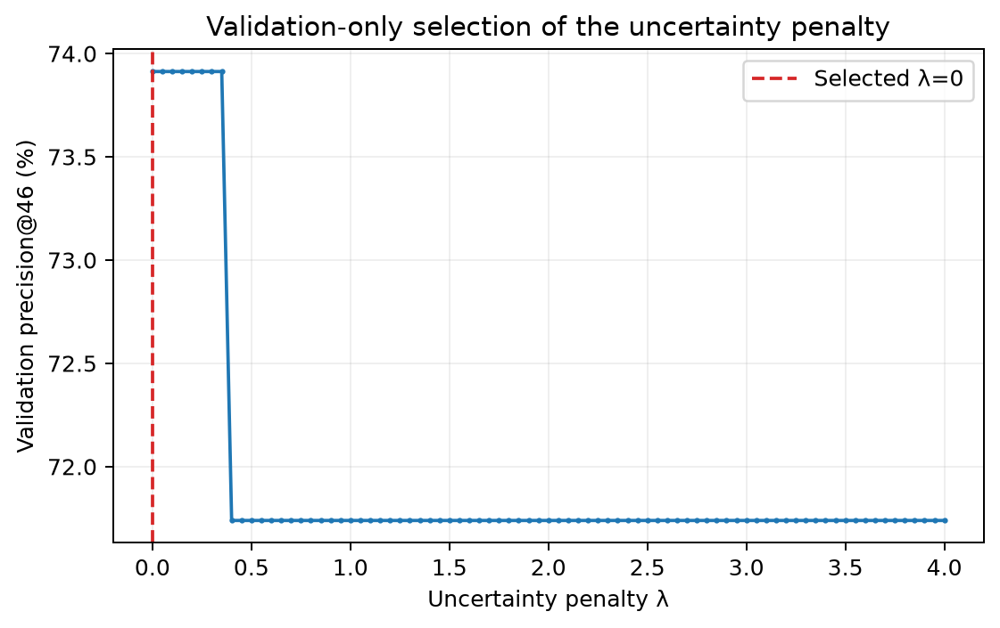

# Point 2: uncertainty-adjusted probability ranking

## Method and validation selection

For each observation, average the 128 hazard probabilities and compute their **sample standard deviation** (ddof=1). Rank by `mean − lambda × SD`, highest first. SD is variability between heads, not the standard error of their average; scores are not clipped to [0,1]. Exact score ties use ascending sample ID.

Search the predeclared grid **0 to 4 in steps of 0.05 (81 candidates)**. Select the largest validation hazard count in the top 46; ties choose the smallest lambda. This avoids tuning a second unrelated metric. The selected penalty is **λ = 0**. There are 8 grid values tied for the best validation precision, spanning λ=0 to 0.35 (see the complete sweep). This is the optimum within this grid, not a claim about every real-valued lambda. `selection.json` is written before loading test labels.

Also report mean-only ranking (λ=0) and the fixed 5th-percentile probability ranking suggested in the PDF. The latter is a descriptive comparator and does not participate in lambda selection. Test data are evaluated once with these prespecified methods; no test lambda sweep is performed.

## Results

| Split | Ranking | Hazards in top 46 | Precision@46 | Recall@46 |
|---|---|---|---|---|
| pitt-val | Mean probability | 34/46 | 73.91% | 21.66% |
| pitt-val | Mean − 0 × SD | 34/46 | 73.91% | 21.66% |
| pitt-val | 5th probability percentile (fixed) | 32/46 | 69.57% | 20.38% |
| pitt-test | Mean probability | 27/46 | 58.70% | 15.52% |
| pitt-test | Mean − 0 × SD | 27/46 | 58.70% | 15.52% |
| pitt-test | 5th probability percentile (fixed) | 26/46 | 56.52% | 14.94% |

- **pitt-val:** adjusted ranking retrieves +0 hazards versus the mean ranking, a +0.00 percentage-point difference. 46/46 selected observations overlap.
- **pitt-test:** adjusted ranking retrieves +0 hazards versus the mean ranking, a +0.00 percentage-point difference. 46/46 selected observations overlap.

## Interpretation

The validation-selected penalty is zero: this experiment does not support penalizing uncertainty to improve precision at the chosen budget.

The selected score retrieves 34 hazards on validation and 27 on test. The fixed lower-quantile alternative retrieves 32 and 26, respectively; it provides no improvement on these sets.

Each additional correct retrieval changes precision@46 by 2.17 percentage points. The validation maximum is optimistic because it was used to select lambda. These are comparisons on the same small held-out sets, without a sampling confidence interval or a significance claim. Variability across heads is a different quantity from uncertainty in population precision.

Mean ranking maximizes expected hazard yield when the probabilities represent the correct predictive expectation. Subtracting SD expresses a preference for stability; it does not in general maximize expected yield. Shared errors of all heads can remain highly confident.

## Artifacts and reproducibility

- [Frozen selection](selection.json), [complete validation sweep](validation_lambda_sweep.csv), [metrics and selection changes](metrics.json), [input and code hashes](provenance.json).
- `pitt-{val,test}_{mean,adjusted,lower_q05}.csv` contains every observation, metadata, probability summaries and ranking score; `_top46.csv` contains exactly the selected review set.
- `validation_lambda_sweep.{png,pdf}` contains the figure in raster/vector formats.
- Run from the repository root: `python -m uncertainty_analysis.point_2_adjusted_scores --k 46`.

Source: `/data/repo/MLiP/notebooks/colab_results/ensemble/128_bootstrap.zip`; run `20261126T230142Z-92d44f`; archive SHA-256 `806c54b8e09749ef5d677ee0dcbf7394793d7f87a9b9818cfef41b845ab000e0`. The source model is frozen DINOv3 ViT-B/16 with 128 independently fitted linear heads. Each head uses a replacement bootstrap of the 1,276 Pitt training records (527 hazards, 749 non-hazards), sampling exact-pixel clusters stratified by binary-label composition. Other-city training images are not used. Settings are Adam, learning rate 3e-5, weight decay 0.01, batch size 64, 5,000 updates, unweighted binary cross-entropy, final checkpoint. We keep the historical fixed budget k=46: 12.0419% of 382 validation observations and 12.1053% of 380 test observations. Test labels are used only to score completed rankings, never to fit lambda or choose the pairwise solver.

These frequencies and intervals describe variability across fitted bootstrap heads conditional on the shared frozen representation and dataset. They are not automatically calibrated Bayesian probabilities or 95% coverage guarantees. Exact duplicate images/annotation conflicts are retained from the dataset. Training predictions are excluded from these held-out comparisons because they include in-bag fits.

Reference: [supplied methods note, point 2](../../reference/uncertainty_in_classifier_rankings.pdf).
