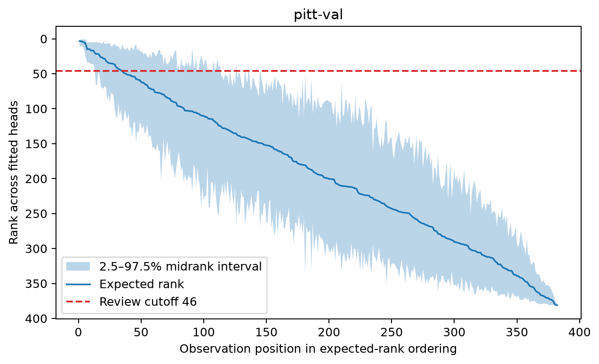
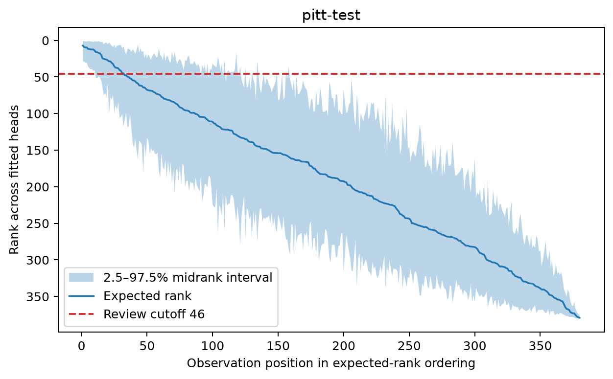
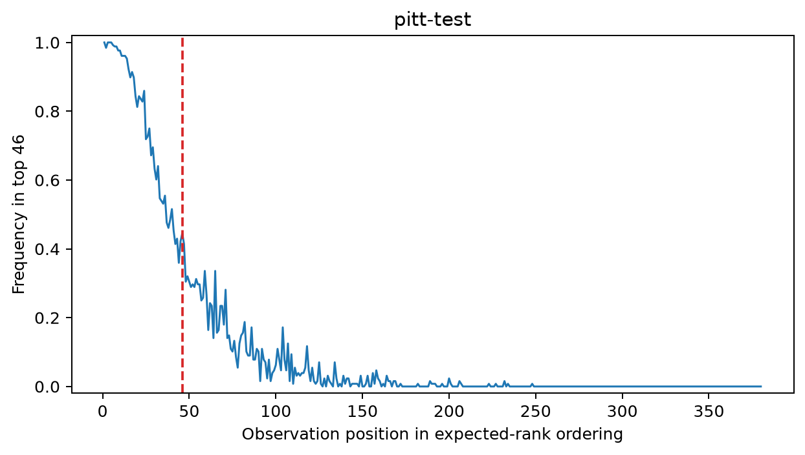

# Point 3: uncertainty in ranks and pairwise comparisons

## Method

Rank all observations **within each of the same 128 heads**, highest hazard probability first. Rank 1 is best. For each observation export mean (expected) rank, median rank, the **2.5th and 97.5th empirical percentiles of rank**, interval width, P(first) and P(top 46). Percentiles use linear interpolation.

Exact probability ties receive **midranks**. For P(first) and P(top k), allocate tied slots equally: if a tie group of size t has a items strictly above it, its top-k contribution is `clip((k−a)/t, 0, 1)`. Thus top-k frequencies sum to k and first-place frequencies sum to 1. The reported rank intervals are intervals of midranks across fits; they do not add hypothetical random tie-breaking noise. Final equal expected ranks use sample ID; top-k-frequency ordering breaks frequency ties by expected rank, then sample ID.

Three fixed rankings are evaluated: mean probability; smallest expected rank (the primary point-3 ranking); and largest P(top k). No labels determine these orderings. Expected midrank is exactly one plus the sum of pairwise loss probabilities with half-credit for ties. Thus this ordering is the weighted Borda ranking. It need not be the pairwise-agreement optimum explored in point 4.

For every observation pair, export `P_strict(i,j) = count_b[p_i(b) > p_j(b)] / 128` and `P_tie(i,j)`. Comparisons use corresponding predictions from the **same head**, not all 128×128 cross-head combinations. Consequently `P_strict(i,j) + P_strict(j,i) + P_tie(i,j) = 1`; the strict diagonal is zero and the tie diagonal is one.

## Retrieval results

| Split | Ranking | Hazards in top 46 | Precision@46 | Recall@46 |
|---|---|---|---|---|
| pitt-val | mean | 34/46 | 73.91% | 21.66% |
| pitt-val | expected rank | 34/46 | 73.91% | 21.66% |
| pitt-val | top k frequency | 34/46 | 73.91% | 21.66% |
| pitt-test | mean | 27/46 | 58.70% | 15.52% |
| pitt-test | expected rank | 27/46 | 58.70% | 15.52% |
| pitt-test | top k frequency | 28/46 | 60.87% | 16.09% |

## Rank stability

| Split | Median interval width | 90th-percentile width | Intervals crossing k | P(top k) ≥ 95% | P(top k) > 0 |
|---|---|---|---|---|---|
| pitt-val | 156.2 | 208.4 | 100 | 14 | 158 |
| pitt-test | 162.2 | 215.8 | 112 | 14 | 171 |

- **pitt-val:** only 14 observations appear in the top 46 with frequency at least 95%; 100 rank intervals cross the cutoff. Expected-rank and mean rankings share 46/46 selected images. Among the ≥95%-stable selections, 9 are labelled hazards and 5 non-hazards.
- **pitt-test:** only 14 observations appear in the top 46 with frequency at least 95%; 112 rank intervals cross the cutoff. Expected-rank and mean rankings share 46/46 selected images. Among the ≥95%-stable selections, 8 are labelled hazards and 6 non-hazards.

Ranking by top-k frequency retrieves 28 test hazards versus 27 for mean ranking, a difference of +1 image(s). The corresponding validation counts are 34 and 34. This is a descriptive comparison of prespecified orderings; the test difference is not used to choose a winner or tune the method.

Wide intervals mean the head ensemble disagrees about placement, even when a single averaged ranking looks precise. P(top k) measures selection stability under these refits; it is **not** the probability the image is a true hazard. An observation may be stably misclassified. Point-3 intervals/frequencies and pairwise probabilities can accompany any downstream ordering without replacing it.

## Artifacts and reproducibility

- `pitt-{val,test}_expected_rank.csv` contains per-image rank intervals/frequencies, mean/SD probabilities, labels and metadata; `_top46.csv` gives the selected images. Comparable files exist for `mean` and `top_k_frequency`.
- `pitt-{val,test}_ranks.{npz,csv}` retains every observation's 128 midranks. NPZ axes are explicitly named by sample IDs and member IDs.
- `pitt-{val,test}_pairwise_probability.csv` is the **full strict outranking matrix**, rows/columns named by sample ID. `_pairwise_tie_probability.csv` retains ties. `_pairwise.npz` includes probabilities and exact counts.
- [Metrics and stability summaries](metrics.json), [provenance](provenance.json); figures are saved as PNG and PDF. Heatmaps of these same probabilities and a pairwise consensus ranking are in [point 4](../point_4/analysis.md).
- Run: `python -m uncertainty_analysis.point_3_rank_distributions --k 46`.

Source: `/data/repo/MLiP/notebooks/colab_results/ensemble/128_bootstrap.zip`; run `20261126T230142Z-92d44f`; archive SHA-256 `806c54b8e09749ef5d677ee0dcbf7394793d7f87a9b9818cfef41b845ab000e0`. The source model is frozen DINOv3 ViT-B/16 with 128 independently fitted linear heads. Each head uses a replacement bootstrap of the 1,276 Pitt training records (527 hazards, 749 non-hazards), sampling exact-pixel clusters stratified by binary-label composition. Other-city training images are not used. Settings are Adam, learning rate 3e-5, weight decay 0.01, batch size 64, 5,000 updates, unweighted binary cross-entropy, final checkpoint. We keep the historical fixed budget k=46: 12.0419% of 382 validation observations and 12.1053% of 380 test observations. Test labels are used only to score completed rankings, never to fit lambda or choose the pairwise solver.

These frequencies and intervals describe variability across fitted bootstrap heads conditional on the shared frozen representation and dataset. They are not automatically calibrated Bayesian probabilities or 95% coverage guarantees. Exact duplicate images/annotation conflicts are retained from the dataset. Training predictions are excluded from these held-out comparisons because they include in-bag fits.

Reference: [supplied methods note, points 3–4](../../reference/uncertainty_in_classifier_rankings.pdf).
