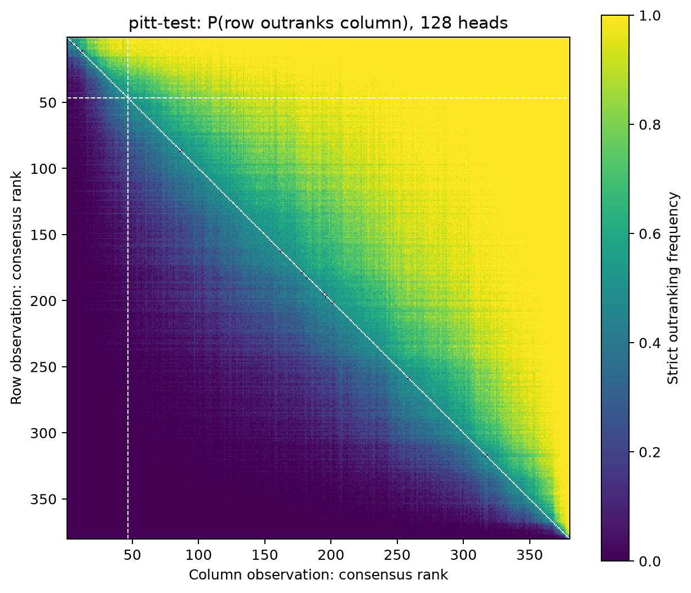
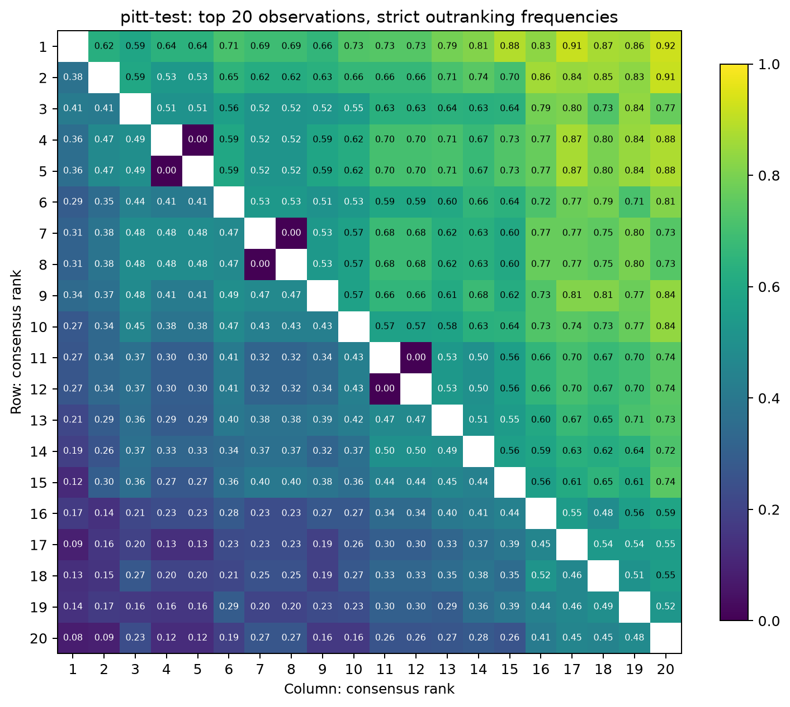

# Point 4: pairwise outranking and consensus ordering

## Pairwise probabilities and heatmaps

For every ordered pair (i,j), compute the fraction of the **same 128 heads** in which `p_i > p_j`. This preserves dependence between images' predictions. Save strict probability and tie probability separately. A pair with 0.5 preference after half-credit for ties is unresolved by this ensemble; it should not be presented as a confident ordering.

Pairs tied in every head have **strict probabilities zero in both directions**; this means identical predicted scores, not evidence that both observations lose to each other. There are 22 such unordered pairs in validation and 12 in test. The companion tie matrix distinguishes them from genuine one-sided preferences.

The full matrices have one row/column per observation, with exact sample IDs in CSV headers. The heatmaps reorder both axes by the consensus ranking, use a shared [0,1] color scale, and mask the diagonal (strict self-outranking is zero). Dashed lines mark the top-46 boundary. `*_heatmap_index.csv` maps each plotted position to its sample ID and image path. Enlarged top-20 plots print probabilities inside cells; full-resolution numeric values are in CSV/NPZ.

## Ranking objective and algorithm

Choose a permutation π maximizing `sum_(a<b) C[π[a], π[b]]`, where C is the integer number of heads preferring the row observation. This is a **Kemeny consensus**, maximizing expected pairwise agreement (equivalently minimizing expected pairwise disagreements). Adding half-credit for probability ties adds the same constant to every permutation, so it does not change the optimum. Expected-rank/Borda ordering optimizes a different positional criterion and is a useful starting point, not a general solution to this objective.

Pairwise majority preferences can cycle, so sorting them directly does not always yield a consistent order. The implementation first decomposes the majority graph into strongly connected components; pairwise ties are edges in both directions. Cross-component preferences then form an acyclic order and can all be satisfied. Each component starts with Borda ordering and deterministic improving insertions.

For nontrivial components, a binary linear-ordering program defines x(i,j)=1 when i precedes j. Constraints `0 ≤ x(i,j)+x(j,k)−x(i,k) ≤ 1` eliminate directed triangles. Rather than load all O(n³) constraints, the solver adds violated triangles iteratively. A feasible insertion ranking is retained throughout. The mixed-integer relaxation's dual bound supplies an **upper bound** on the attainable agreement; an acyclic optimum, or an integer objective gap below one, certifies optimality. The search budget is 240 seconds per split. On timeout the script reports its feasible best effort and a valid remaining gap rather than calling it optimal. Fixed sample-ID ordering governs deterministic heuristic ties. Multiple equally optimal permutations may exist.

## Optimization results

| Split | Components | Largest component | Feasible objective | Upper bound | Unclosed gap | Certified optimal |
|---|---|---|---|---|---|---|
| pitt-val | 56 | 277 | 8235639 | 8235639.000 | 0.000 | Yes |
| pitt-test | 52 | 169 | 8102338 | 8102338.000 | 0.000 | Yes |

Objective units above are integer head-pair agreements. The reported upper bound bounds the best possible ordering on these stored predictions, not performance on true hazards.

| Split | Ranking | Strict agreements | Agreement with half-ties | Certified optimal |
|---|---|---|---|---|
| pitt-val | mean | 8234389 | 88.41731% | — |
| pitt-val | expected_rank | 8233961 | 88.41272% | — |
| pitt-val | consensus | 8235639 | 88.43073% | Yes |
| pitt-test | mean | 8100740 | 87.89478% | — |
| pitt-test | expected_rank | 8100566 | 87.89289% | — |
| pitt-test | consensus | 8102338 | 87.91212% | Yes |

## Retrieval results and interpretation

| Split | Ranking | Hazards in top 46 | Precision@46 | Recall@46 |
|---|---|---|---|---|
| pitt-val | mean | 34/46 | 73.91% | 21.66% |
| pitt-val | expected rank | 34/46 | 73.91% | 21.66% |
| pitt-val | consensus | 34/46 | 73.91% | 21.66% |
| pitt-test | mean | 27/46 | 58.70% | 15.52% |
| pitt-test | expected rank | 27/46 | 58.70% | 15.52% |
| pitt-test | consensus | 27/46 | 58.70% | 15.52% |

- **pitt-val:** consensus changes 277 positions relative to expected-rank/Borda ordering; the top-46 sets overlap in 46 images. Consensus retrieves +0 hazards compared with Borda.
- **pitt-test:** consensus changes 279 positions relative to expected-rank/Borda ordering; the top-46 sets overlap in 45 images. Consensus retrieves +0 hazards compared with Borda.

The ranking is selected entirely from predictions. Hazard labels are consulted only for these final retrieval metrics. Maximizing agreement across heads is **not** the same objective as maximizing hazard yield in the first 46; an optimal consensus need not beat mean ranking on precision. A high global pairwise-agreement fraction can also hide instability near the review boundary, since most pairs are far apart in rank. Use the point-3 rank intervals and top-k frequencies alongside the heatmap.

## Artifacts and reproducibility

- `pitt-{val,test}_consensus.csv` and `_consensus_top46.csv`: final ranking, original image paths/labels and probability summaries.
- `pitt-{val,test}_pairwise_probability.csv`, `_pairwise_tie_probability.csv`, `_pairwise.npz`: full matrices, exact counts and ID axes (same definition as point 3).
- `pitt-{val,test}_solver.json`: component sizes, every solver round, timing, objective and optimality bound; `*_heatmap_index.csv` identifies plotted observations.
- [Retrieval metrics](metrics.json), [provenance](provenance.json); all figures have PNG and vector PDF versions.
- Run: `python -m uncertainty_analysis.point_4_pairwise_consensus --k 46 --solver-seconds 240`.

Source: `/data/repo/MLiP/notebooks/colab_results/ensemble/128_bootstrap.zip`; run `20261126T230142Z-92d44f`; archive SHA-256 `806c54b8e09749ef5d677ee0dcbf7394793d7f87a9b9818cfef41b845ab000e0`. The source model is frozen DINOv3 ViT-B/16 with 128 independently fitted linear heads. Each head uses a replacement bootstrap of the 1,276 Pitt training records (527 hazards, 749 non-hazards), sampling exact-pixel clusters stratified by binary-label composition. Other-city training images are not used. Settings are Adam, learning rate 3e-5, weight decay 0.01, batch size 64, 5,000 updates, unweighted binary cross-entropy, final checkpoint. We keep the historical fixed budget k=46: 12.0419% of 382 validation observations and 12.1053% of 380 test observations. Test labels are used only to score completed rankings, never to fit lambda or choose the pairwise solver.

These frequencies and intervals describe variability across fitted bootstrap heads conditional on the shared frozen representation and dataset. They are not automatically calibrated Bayesian probabilities or 95% coverage guarantees. Exact duplicate images/annotation conflicts are retained from the dataset. Training predictions are excluded from these held-out comparisons because they include in-bag fits.

References: [supplied note, point 4](../../reference/uncertainty_in_classifier_rankings.pdf); [Kemeny ranking algorithms and computational complexity](https://aamas.csc.liv.ac.uk/Proceedings/aamas09/pdf/01_Full%20Papers/11_25_140_FP_0418.pdf); [SciPy mixed-integer programming interface and bound definitions](https://docs.scipy.org/doc/scipy/reference/generated/scipy.optimize.milp.html).
